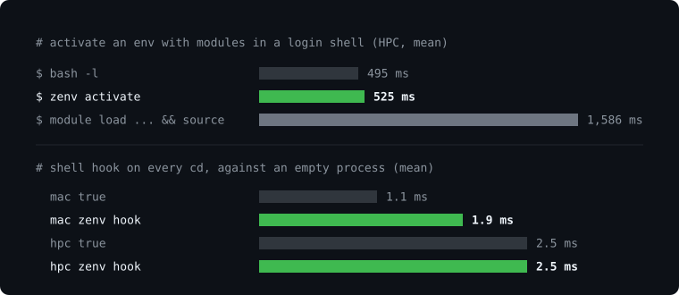

# zenv

Project environments, defined in one file.

`zenv` sets up everything a project needs to run and switches it on for you. You describe the environment in a `zenv.json` file next to your code, and zenv builds it. An environment can hold a Python virtual environment with its packages, environment variables, HPC modules, and shell commands to run at setup or activation. Every part is optional, so a Python project on a laptop can use zenv for its venv alone, and a C++ project on a cluster can use it for compilers and variables with no Python at all.

zenv is a single binary. It does not need Python to run, and it works on Linux and macOS.

## Why zenv

- **One file describes the environment.** `zenv.json` lives with your code, so the setup is written down and anyone can rebuild it with one command.
- **Use an environment from any directory.** Every environment has a name. You can activate it, run a command in it, or jump to its project from wherever you are.
- **It activates when you enter the project.** With the shell hook, `cd` into a project turns its environment on, and leaving turns it off.
- **It stays up to date.** When you change `zenv.json` or your requirements file, zenv rebuilds the environment the next time you use it.
- **The same file works on a laptop and on a cluster.** One `zenv.json` can hold a separate environment for each machine, and zenv picks the one that matches where you are.
- **Activation is fast on HPC systems.** zenv saves the result of `module load` once and reuses it, so you do not wait for the module system each time.



On the HPC system we measured, activating an environment with modules takes about 0.5 seconds with zenv and about 1.6 seconds by hand. The shell hook adds about 2 milliseconds to a `cd`.

## Install

Use the install script. Run the same command again later to update.

```sh
curl -fsSL https://raw.githubusercontent.com/anoopkcn/zenv/HEAD/install.sh | bash
```

Or use Homebrew, and update later with `brew upgrade zenv`.

```sh
brew install anoopkcn/zenv/zenv
```

<details>
<summary>Other ways to install</summary>

To install a release by hand, download the archive for your system from the [releases page](https://github.com/anoopkcn/zenv/releases), unpack it, and move the `zenv` binary to a directory on your `PATH`.

```sh
# Replace <tag> with the latest release version
curl -LO "https://github.com/anoopkcn/zenv/releases/download/<tag>/zenv-x86_64-linux-musl.tar.gz"
tar -xvf zenv-x86_64-linux-musl.tar.gz
mv zenv ~/.local/bin/
```

To build from source, you need [Zig](https://ziglang.org).

```sh
git clone https://github.com/anoopkcn/zenv.git
cd zenv
zig build
mv zig-out/bin/zenv ~/.local/bin/
```

</details>

zenv supports Linux and macOS on `x86_64` and `aarch64`. Windows support is not planned.

## Quick start

Go to your project and create an environment. This example calls it `myenv`.

```sh
cd my-project
zenv setup myenv --init
```

This writes a `zenv.json` and builds the environment from it. If the project has a `requirements.txt` or a `pyproject.toml`, zenv finds it and installs the packages it lists.

Now use the environment. You can run a single command in it:

```sh
zenv run myenv python train.py
```

Or you can activate it in your shell, and type `deactivate` when you are done:

```sh
source $(zenv activate myenv)
```

Inside the project you can write `.` instead of the name, as in `zenv run . pytest`.

## The zenv.json file

Each top-level key in `zenv.json` is one environment. This example has an environment for any machine and another for the JURECA cluster.

```json
{
  "dev": {
    "target_machines": ["*"],
    "description": "Development environment for any machine",
    "dependency_file": "requirements.txt",
    "env": { "PROJECT_DATA": "${ZENV_PROJECT_DIR}/data" }
  },
  "dev-jureca": {
    "target_machines": ["jureca"],
    "description": "Development environment on JURECA",
    "modules": ["Stages/2025", "StdEnv", "Python"],
    "dependency_file": "requirements.txt"
  }
}
```

Only `target_machines` is required. These are the keys you will use most:

| Key | What it does |
|---|---|
| `target_machines` | The machines this environment is for. `["*"]` means any machine. |
| `description` | A short note that `zenv ls` shows. |
| `dependency_file` | A `requirements.txt` or `pyproject.toml` with the packages to install. |
| `env` | Environment variables to set. |
| `modules` | HPC modules to load. |
| `setup`, `activate` | Shell commands to run when the environment is built or activated. |
| `python` | Set it to `false` for an environment without Python. |
| `container` | An Apptainer or Docker image to run the environment in. |

`zenv init` and `zenv setup --init` write two `env` entries into a new Python environment. `"PYTHONDONTWRITEBYTECODE": ""` lets Python save compiled bytecode, which makes later starts faster. `"PYTHONPYCACHEPREFIX"` makes Python keep those files in one directory, `pycache` under `base_dir`, and not in `__pycache__` directories next to every source file. When `ZENV_PYCACHE_DIR` is set while the entry is written, its value is used as that directory, for example a path on a scratch filesystem where files are cheap. Change or delete either entry as you like. An environment without them follows Python's defaults.

The file may contain `//` and `/* */` comments. After you edit it, `zenv validate` checks it and reports any mistake with its line number. There are more keys than this table shows, and `zenv help` describes them.

## What you can do with it

### Run a command without activating

`zenv run` runs one command inside an environment and leaves your shell as it was. This works well in scripts, in CI, and for starting an editor or a server.

```sh
zenv run myenv python train.py
zenv run myenv jupyter notebook
zenv run myenv vim
```

### Activate when you enter a project

Add one line to your shell's startup file, and zenv will activate a project's environment when you `cd` into the project and deactivate it when you leave.

```sh
eval "$(zenv hook zsh)"     # in ~/.zshrc
eval "$(zenv hook bash)"    # at the end of ~/.bashrc
```

The hook only activates environments that you have built yourself with `zenv setup`. A `zenv.json` in a repository you just cloned does nothing until you set it up.

### Add and remove packages

`zenv add` installs a package and writes it into your `requirements.txt`, `pyproject.toml` or `zenv.json`. Because the package is written down, it is still there the next time the environment is built.

```sh
zenv add myenv requests
zenv add myenv "numpy>=1.26,<2.0"
zenv add myenv pytest --dev
```

zenv installs packages with [uv](https://docs.astral.sh/uv/) when uv is installed, and with pip otherwise.

`zenv remove` undoes `zenv add`. It takes the package out of the file it was written into and uninstalls it from the environment.

```sh
zenv remove myenv requests
zenv remove myenv pytest --dev
```

Give `zenv remove` the same options you gave `zenv add`, such as `--dev`, so that it looks in the same place. When the package is written down somewhere else, zenv removes nothing and tells you which option to use. A package stays installed when another package in the environment still requires it. Packages that were installed only because the removed package required them also stay, until the environment is next rebuilt.

### Environments that stay up to date

You do not need to remember to rebuild. When `zenv.json` or a file it points to has changed, the next `zenv run` or `zenv activate` rebuilds the environment first and then carries on. You can also rebuild at any time with `zenv setup <name>`.

### HPC modules and several machines

List the modules an environment needs under `modules`. zenv loads them when it builds the environment and saves the result, so later activations reuse the saved result and do not call the module system again. If a module fails to load, the build stops and tells you which one. Packages that the modules already provide are not installed a second time.

`target_machines` ties each environment to a machine, and the name matches on login nodes and compute nodes alike. When a project has an environment for each cluster, you can give them all one alias. That alias then picks the right environment on each machine:

```sh
zenv alias create dev dev-jureca
zenv alias create dev dev-juwels
zenv run dev python train.py
```

### Projects without Python

Set `"python": false` to get an environment with only modules, variables and shell commands. `zenv setup <name> --init --no-python` creates one for you.

```json
{
  "tools": {
    "target_machines": ["*"],
    "python": false,
    "modules": ["GCC", "CMake"],
    "env": { "OMP_NUM_THREADS": "8" }
  }
}
```

### Containers

With `container`, an environment runs inside an [Apptainer](https://apptainer.org) or [Docker](https://www.docker.com) image. This suits software that ships as a container, such as a PyTorch image. zenv builds the venv on the image's Python and installs only the packages that the image does not already have, so `import torch` gets the image's copy. `zenv run` starts your command inside the image.

```json
{
  "train": {
    "target_machines": ["jupiter"],
    "container": { "image": "containers/pytorch.sif", "options": ["--nv"] },
    "dependency_file": "pyproject.toml"
  },
  "laptop": {
    "target_machines": ["my-laptop"],
    "container": { "runtime": "docker", "image": "pytorch/pytorch:2.5.1-cuda12.4-cudnn9-runtime" },
    "dependency_file": "pyproject.toml"
  }
}
```

`runtime` is `apptainer` (the default) or `docker`. For Apptainer, `image` is a `.sif` file or a URI such as `docker://...`. For Docker it is an image reference, which `docker run` pulls when it is missing. `options` are passed to `apptainer exec` or `docker run`, and `bind` adds `src[:dest[:opts]]` binds.

zenv itself stays on the host and only starts commands in the image, so the image needs nothing from zenv. It needs `sh` and `env`, and for a Python environment `python3` with `pip`. The project directory, the environment directory and the directory you run from are bound into the image at the same paths. The image is only read, and a newer image under the same name rebuilds the environment on its next use.

A few things differ from other environments:

- A container environment cannot be activated. Use `zenv run <name> <command>`, or `zenv run <name> bash` for a shell.
- Packages are installed with the host's uv when the host runs Linux, and with the image's pip otherwise (on macOS the host's uv cannot run in a Linux image).
- A requirement that needs another version of a package the image provides fails setup. `--force` installs every dependency into the venv instead.
- zenv sets `PYTHONNOUSERSITE=1` in a container environment. Apptainer binds your home directory, and without the variable the packages in `~/.local/lib/pythonX.Y/site-packages` on the host would be importable in the image. An `env` entry in `zenv.json` can set it to another value.
- Docker passes no host variables into the image and runs the image's default user, which is usually root. On a Linux host with rootful Docker the files in the environment directory are then owned by root, unless you add `"options": ["--user", "<uid>:<gid>"]`.
- `zenv jupyter create` refuses a Docker environment, because Jupyter cannot reach a kernel inside the container.

### Jupyter kernels

`zenv jupyter create myenv` makes a Jupyter kernel for an environment. The kernel gets the environment's modules and variables, even when the Jupyter server itself runs somewhere else. The environment needs the `ipykernel` package, which you can add with `zenv add myenv ipykernel`.

## Common commands

| Command | What it does |
|---|---|
| `zenv setup <name> --init` | Write `zenv.json` and build the environment in one step. |
| `zenv setup <name>` | Build or rebuild the environment from `zenv.json`. |
| `zenv run <name> <command>` | Run a command inside the environment. |
| `source $(zenv activate <name>)` | Activate the environment in your shell. |
| `zenv add <name> <package>` | Install a package and record it. |
| `zenv remove <name> <package>` | Uninstall a package and remove its record. |
| `zenv ls` | List the environments for this machine. |
| `cd $(zenv cd <name>)` | Go to the environment's project directory. |
| `zenv validate` | Check `zenv.json` for mistakes. |
| `zenv rm <name>` | Delete the whole environment. |

In place of `<name>` you can give an alias, the first seven or more characters of the environment's id, or `.` for the project you are in.

## Getting help

`zenv help` prints the full reference: every command, every option and the `zenv.json` keys. `zenv help <command>` and `zenv <command> --help` show the help for one command.

If a setup fails, `zenv log <name>` shows what happened. If you find a bug, please [open an issue](https://github.com/anoopkcn/zenv/issues). Setting `ZENV_DEBUG=1` prints debug output that is useful to include.

## License

[MIT License](LICENSE)
